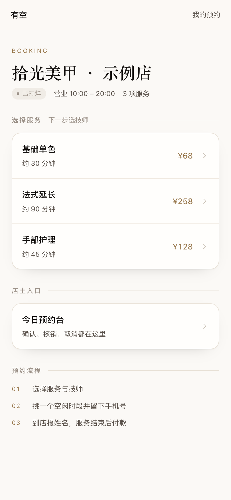
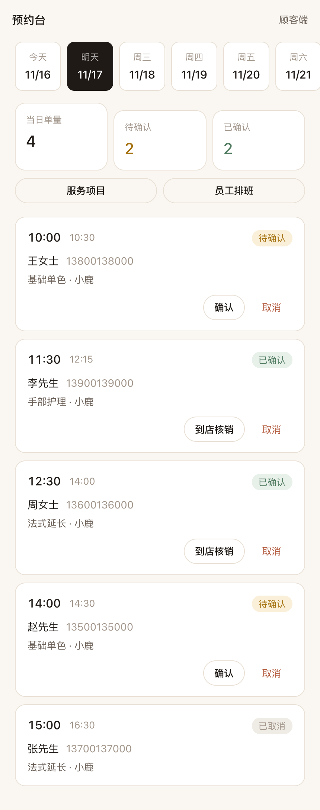
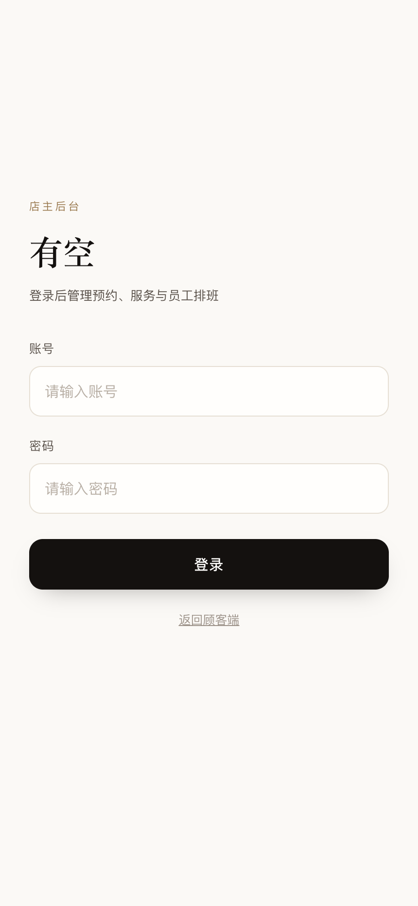
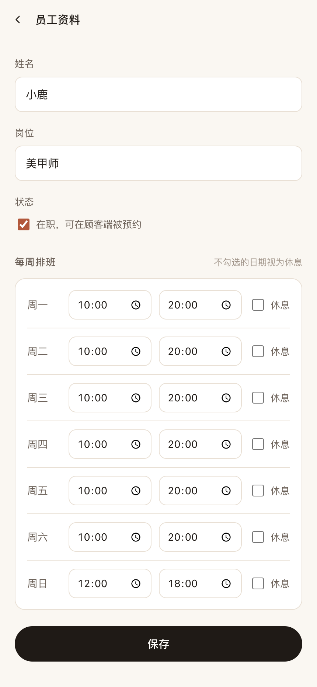
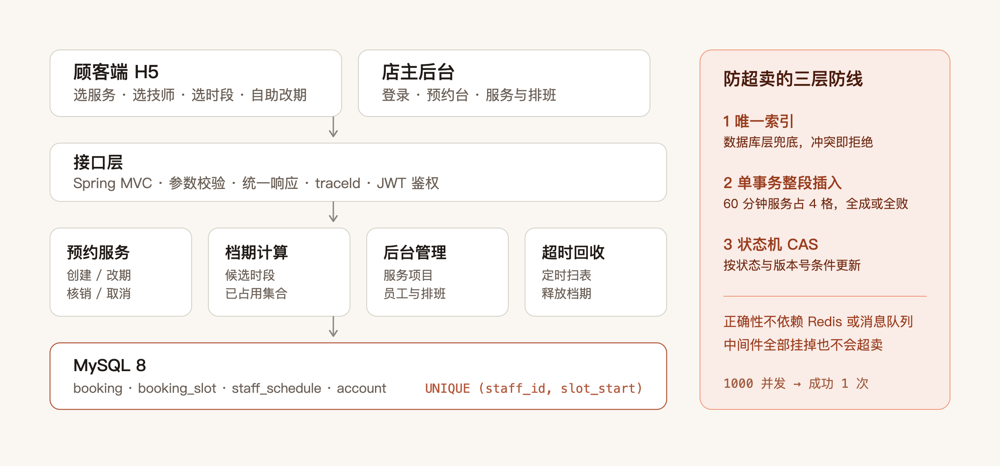

# 有空

[](https://github.com/John-git884/you-kong/actions/workflows/ci.yml)

面向线下门店的在线预约与排班系统。顾客在手机上选服务、选技师、选时段完成预约，可以自助改期和取消；店主登录后台确认、核销，并维护服务项目与员工排班。

技术上只讲一件事：**时间被切成固定粒度的格子，"不超卖"由数据库唯一索引保证，不依赖任何分布式锁。**

<table>
  <tr>
    <td></td>
    <td></td>
    <td></td>
  </tr>
  <tr>
    <td align="center">顾客选服务</td>
    <td align="center">选时段</td>
    <td align="center">店主预约台</td>
  </tr>
  <tr>
    <td></td>
    <td></td>
    <td></td>
  </tr>
  <tr>
    <td align="center">后台登录</td>
    <td align="center">员工排班</td>
    <td></td>
  </tr>
</table>

## 功能

**顾客端**
- 按服务项目浏览，展示时长与价格
- 选择技师，查看未来 7 天的空闲时段
- 提交预约（姓名 + 手机号），进入待确认状态
- 用手机号查历史预约，可改期、可取消

**店主端**（需登录，JWT 鉴权）
- 预约台：按日查看全部预约，显示当日单量、待确认、已确认
- 预约操作：确认、到店核销、取消（取消后档期立即释放）
- 服务项目：新增、编辑、删除，删除前校验是否已有预约记录
- 员工管理：新增、修改资料、上下架，按周配置排班

## 技术栈

| 层 | 选型 |
| --- | --- |
| 后端 | Java 17 · Spring Boot 3.2 · MyBatis-Plus 3.5 |
| 鉴权 | Spring Security 6 · JWT（jjwt）· BCrypt |
| 数据库 | MySQL 8（生产）/ H2 内存库（本地零配置） |
| 前端 | Vue 3 · Vue Router · Vite，手写 CSS 无 UI 框架 |
| 测试 | JUnit 5 · AssertJ · MockMvc |
| 压测 | k6 |
| 交付 | Docker 多阶段构建 · docker compose · GitHub Actions |

## 架构



请求自上而下经过客户端、接口层、业务层，最终落到 MySQL。右侧是整套设计真正的立足点：正确性由数据库唯一索引保证，不依赖任何中间件。

## 核心设计

### 时间槽与唯一索引

时间按 15 分钟离散化，`booking_slot` 一表一格，`(staff_id, slot_start)` 建唯一索引。

```
一个 60 分钟的服务 = 同一事务内插入 4 行
并发抢同一格   = 数据库拒绝插入 = 业务返回 2001
取消预约       = 删除对应行 = 档期释放
改期           = 先释放原档期，再占新档期，同一事务
```

这条路上试过的几种方案：

| 方案 | 并发正确性 | 说明 |
| --- | --- | --- |
| 应用层先查后插 | 有竞态，会超卖 | 检查与写入之间有空窗 |
| Redis 分布式锁 | 依赖 Redis 可用性 | 主从切换时可能丢锁 |
| 唯一索引 | 由存储引擎保证 | 采用 |
| `SELECT ... FOR UPDATE` | 正确 | 锁范围大，容易死锁，备选 |

价值在于正确性不依赖中间件：Redis 挂掉、消息队列丢消息，超卖依然不会发生。

### 三层防线

1. **唯一索引**：数据库层兜底，正确性的唯一真相来源
2. **单事务整段插入**：不会出现只占了半小时的脏数据
3. **状态机 CAS**：`update ... where status = ? and version = ?`，并发下只有一次生效

### 改期的顺序

改期要同时动两个档期，先删旧槽位再插新槽位，原因写在 `BookingService#reschedule` 的注释里：

- 新时段可能与旧时段重叠（例如 10:00 改到 10:15），反过来先插会撞上自己的唯一索引
- 删和插在同一事务内，新档期被别人占了就整体回滚，原档期不会丢
- 主单更新带 `version` 乐观锁，两个人同时改期只有一个成功

### 超时回收

预约创建后是 `PENDING`，5 分钟未确认自动取消并释放档期，由 `ExpireJob` 每分钟扫一次。

用扫表而不是 Redis ZSet 延迟队列：单店量级下每分钟扫一次 PENDING 小表成本可忽略，少一个中间件依赖，扫表天然幂等、进程重启不丢任务。量上来之后改成 Redis ZSet 触发 + 扫表兜底。

### 可观测

每个请求由 `TraceIdFilter` 分配一个 `traceId`，写入 MDC 与响应头 `X-Request-Id`，日志格式里带出来。排查问题时拿这个 id 就能串起一次请求的全部日志。

### 鉴权

顾客端不需要账号——输入手机号就能预约，这是美业这类门店的真实形态。需要保护的是后台：

| 范围 | 规则 |
| --- | --- |
| `/api/auth/login` | 放行 |
| `/api/admin/**` | 必须带有效 JWT |
| 其余接口与静态资源 | 放行 |

- 登录成功后签发 HS256 的 JWT，有效期默认 12 小时，前端存在 localStorage，请求时放进 `Authorization: Bearer`
- 密码用 BCrypt 存储；账号不存在时也跑一次哈希比对，避免通过响应耗时判断账号是否存在
- 无状态：不建 session，服务端不存 token，多实例部署不需要共享会话
- 未通过校验时返回 HTTP 401 + `{"code": 4001}`，前端收到后清掉本地 token 并跳回登录页

初始账号在首次启动时写入（默认 `owner` / `youkong123`），通过 `ADMIN_USER`、`ADMIN_PASSWORD` 覆盖。上线前必须替换 `JWT_SECRET`，否则签名密钥是公开的默认值。

## 目录结构

```
youkong/
├── src/main/java/com/youkong/
│   ├── common/       统一响应、错误码、业务异常、全局异常处理、traceId 过滤器
│   ├── entity/       6 张表的实体
│   ├── mapper/       MyBatis-Plus Mapper
│   ├── service/      SlotCalculator（纯函数）· SlotService · BookingService
│   │                 BookingQueryService · AdminService · ExpireJob
│   ├── controller/   BookingController · ShopController · AdminController · SpaController
│   └── dto/          请求响应对象
├── src/main/resources/
│   ├── application.yml / application-prod.yml
│   ├── sql/          schema.sql + data.sql
│   └── static/       前端构建产物（git 忽略）
├── src/test/java/    单测 + 并发集成测试 + 改期回归 + 接口冒烟
├── web/              Vue 3 前端
├── sql/init-mysql.sql
├── loadtest/         并发压测脚本（Node 零依赖版 + k6 版）
├── Dockerfile · docker-compose.yml · .github/workflows/ci.yml
└── api.http          接口调试用例
```

## 快速开始

需要 JDK 17，Maven 由 wrapper 自带。

```bash
./mvnw spring-boot:run
# 打开 http://localhost:8080
```

内置 H2 内存库与示例数据（1 家店、2 名美甲师、3 个服务、7 天排班），启动即可用。前端已构建好放在 `src/main/resources/static`，随 jar 一起提供。

- 顾客端：`http://localhost:8080/`
- 店主后台：`http://localhost:8080/admin`，初始账号 `owner` / `youkong123`

改前端时用开发模式：

```bash
cd web
npm install
npm run dev        # 5173 端口，/api 代理到 8080
```

改完构建进后端静态目录，再打包就是一个 jar：

```bash
cd web && npm run build && cd ..
./mvnw package
```

### 换成 MySQL

```bash
mysql -u root -p < sql/init-mysql.sql
```

```yaml
spring:
  datasource:
    url: jdbc:mysql://localhost:3306/youkong?useUnicode=true&characterEncoding=utf8
    driver-class-name: com.mysql.cj.jdbc.Driver
    username: root
    password: 你的密码
  sql:
    init:
      mode: never      # 生产不要每次启动都跑种子数据
```

## 部署

### 单 jar

```bash
export JWT_SECRET=$(openssl rand -base64 48)
export ADMIN_PASSWORD=换成你的密码

java -jar target/youkong-0.1.0.jar --spring.profiles.active=prod \
  --DB_HOST=127.0.0.1 --DB_PASSWORD=xxx
```

`application-prod.yml` 里数据库连接全部走环境变量，`sql.init` 关闭，H2 控制台关闭。

### Docker

```bash
docker compose up -d --build
```

`docker compose` 会起 MySQL 8 并自动执行 `sql/init-mysql.sql`，应用等 MySQL healthcheck 通过后再启动。

Dockerfile 是三阶段构建：Node 构建前端 → Maven 打包后端（把前端产物塞进 static）→ JRE 运行时镜像。

## 接口

统一响应 `{ "code": 0, "message": "ok", "data": {...} }`，错误码分段：`1xxx` 参数、`2xxx` 档期、`3xxx` 状态流转、`5xxx` 服务异常。

**鉴权**

| 方法 | 路径 | 说明 |
| --- | --- | --- |
| POST | `/api/auth/login` | 账号密码换 token |
| GET | `/api/auth/me` | 校验当前 token 是否有效 |

**顾客端**

| 方法 | 路径 | 说明 |
| --- | --- | --- |
| GET | `/api/shops/{id}` | 店铺信息 |
| GET | `/api/shops/{id}/staff` | 可预约的员工 |
| GET | `/api/shops/{id}/services` | 服务项目 |
| GET | `/api/availability` | 某天可约开始时间，参数 `staffId` `serviceId` `date` |
| POST | `/api/bookings` | 创建预约，预占档期 |
| GET | `/api/bookings/{id}` | 预约详情 |
| GET | `/api/bookings/mine` | 按手机号查预约 |
| POST | `/api/bookings/{id}/confirm` | 确认 |
| POST | `/api/bookings/{id}/complete` | 到店核销 |
| POST | `/api/bookings/{id}/reschedule` | 改期，body `{ "startAt": "..." }` |
| POST | `/api/bookings/{id}/cancel` | 取消并释放档期 |

**店主端**（以下接口都需要 `Authorization: Bearer <token>`）

| 方法 | 路径 | 说明 |
| --- | --- | --- |
| GET | `/api/admin/shops/{id}/bookings` | 按日查询，参数 `date` |
| GET/POST | `/api/admin/shops/{id}/services` | 服务列表 / 新增 |
| PUT/DELETE | `/api/admin/services/{id}` | 编辑 / 删除 |
| GET/POST | `/api/admin/shops/{id}/staff` | 员工列表 / 新增 |
| PUT | `/api/admin/staff/{id}` | 编辑员工 |
| GET/PUT | `/api/admin/staff/{id}/schedules` | 查询 / 覆盖周排班 |

`api.http` 里可以直接点击运行。

## 测试

```bash
./mvnw test
```

| 测试类 | 覆盖内容 |
| --- | --- |
| `SlotCalculatorTest` | 时长换算槽位、向上取整、候选开始时间 |
| `ApiSmokeTest` | 店铺 / 可用时段 / 创建 / 重复提交返回 2001 / 时间未对齐返回 1001 |
| `BookingConcurrencyTest` | 20 线程抢同一档期，断言成功数为 1、占用槽位数等于服务时长格数 |
| `BookingRescheduleTest` | 改期迁移槽位、改到占用时段时原档期不受影响、被引用服务不可删 |
| `SecurityTest` | 未登录返回 401、登录拿 token、错误密码 4002、伪造 token 被拒、顾客端免登录 |

共 17 个用例。并发测试实测输出：

```
success=1  slotTaken=19  unexpected=0  occupiedSlots=2
```

## 压测

两个脚本测同一件事：`loadtest/contention.mjs` 是零依赖的 Node 版（下面的数据由它跑出来），`loadtest/booking-contention.js` 是 k6 版，给压测机或 CI 用。

```bash
node loadtest/contention.mjs --vus 1000 --start-at 2026-11-26T13:00:00
k6 run -e START_AT=2026-11-26T13:00:00 loadtest/booking-contention.js
```

判定标准只有一条：不管多少请求同时抢同一个时间槽，成功数必须恰好为 1。

### 实测结果

环境：Apple Silicon / JDK 17 / H2 内存库 / 单实例 / 压测客户端与服务器同机。

| 并发 | 成功 | 档期冲突 2001 | 异常 | p50 | p95 | p99 |
| --- | --- | --- | --- | --- | --- | --- |
| 200 | 1 | 199 | 0 | 212 ms | 224 ms | 238 ms |
| 500 | 1 | 499 | 0 | 327 ms | 342 ms | 357 ms |
| 1000 | 1 | 999 | 0 | 453 ms | 535 ms | 544 ms |

三轮共 1700 次请求，每轮成功数都恰好为 1，事后按日期查库没有出现重复档期。

### 一次没收益的调优

p99 偏高，先怀疑连接池（默认 10 条）。把池子调到 50 重跑 1000 并发：

| 连接池 | p50 | p95 | p99 |
| --- | --- | --- | --- |
| 10（默认） | 453 ms | 535 ms | 544 ms |
| 50 | 546 ms | 686 ms | 692 ms |

反而更慢。H2 是内存库，一次查询没有网络往返，连接从来不是瓶颈，加大池子只增加了调度开销，所以保持默认值。

时间主要花在 Tomcat 线程的同步阻塞上——每个请求要串行做几次查询再写两行。要真正降延迟得改业务链路（缓存排班、批量插入槽位），而不是调池子。

### 这组数字怎么读

- 单机单实例、内存库、客户端与服务端抢同一块 CPU，绝对值不能当生产容量承诺
- 真正与机器无关的结论是：**正确性来自唯一索引，不随并发升高而退化**
- 换成 MySQL 后的数字会不同，唯一索引的语义一致，但多了网络往返和行锁竞争

## 已知限制

| 限制 | 原因 | 下一步 |
| --- | --- | --- |
| 无在线支付 | 个人主体无法开通微信支付商户号 | 换成企业主体后加定金，回调做幂等 |
| 无临时请假 | 只做了周排班模板 | 加 `staff_schedule_exception` 叠加，查询时合并 |
| 可用时段在内存计算 | 单店单日只有几百行 | 数据量上来后下推到 SQL 或用位图 |
| 只有单一店主账号 | 先把链路打通 | 加账号管理，按角色区分店主 / 店长 / 员工的权限 |
| 单店单实例 | 项目规模不需要微服务 | 按店铺分库或读写分离，而不是拆服务 |
